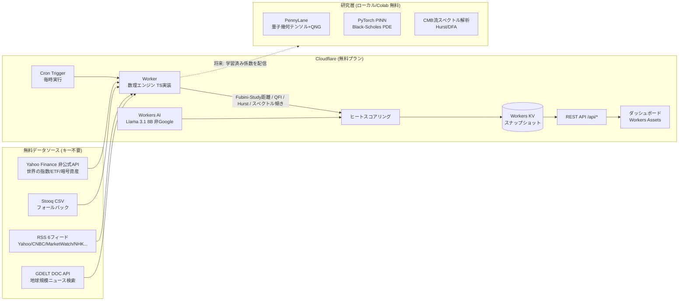

# QAIZ — Quantum-geometric AI Zone 🌌📈

**「どのセクターがこれから熱くなりそうか」** を、量子情報幾何学 × 宇宙論的時系列解析 × AIセンチメントで予測し、Cloudflareエッジから世界中に配信するオープンソース・クオンツレーダー。

**運用コスト: 0円。** すべて無料枠・キー不要APIで構成。AIは Cloudflare Workers AI (Meta Llama — **非Google**)。

---

## アーキテクチャ



## 数理エンジン (エッジで毎時計算)

| レイヤー | 指標 | 意味 |
|---|---|---|
| 量子情報幾何 | 忠実度 F = \|⟨ψ₁\|ψ₂⟩\|² | リターン系列を確率振幅に写像した擬似量子状態の窓間類似度 |
| 〃 | Fubini-Study 距離 arccos(√F) | 状態空間の測地距離。大 = **レジーム転換 (相転移) の兆候** |
| 〃 | QFI 近似 | 量子Fisher情報の古典近似。市場状態の時間感応度 |
| 〃 | 振幅エントロピー | 不確実性の定量化 |
| 宇宙論スペクトル | Hurst 指数 (R/S) | >0.5 トレンド持続 / <0.5 平均回帰。モメンタム有効性のレジーム判定 |
| 〃 | スペクトル傾き | CMBパワースペクトル解析と同型の log-log 回帰。長期変動の支配度 |
| モメンタム | 1週/1ヶ月/3ヶ月 + ボラ調整 + トレンド一貫性 | 実証的に頑健なベースシグナル |
| AIセンチメント | Workers AI (Llama 3.1) によるヘッドライン評価 ±1.0 | 「人の言葉」レイヤー。無料枠超過時はレキシコンに自動フォールバック |

これらを `src/engine/scoring.ts` で合成し、セクターごとに **ヒートスコア 0–100** を算出。Hurstがトレンド持続を示すときはモメンタムを増幅し、Fubini-Study距離が大きい (相転移中) ときは初動方向にブーストを与える設計。

## 監視対象

- **米国セクターETF 13種** (XLK/SMH/XLF/XLE/XLV/XLI/XLY/XLP/XLU/XLB/XLRE/XLC/GLD) + 宇宙・防衛 (ARKX) + 暗号資産 (BTC) + 日本株 (TOPIX ETF)
- **世界12指数** (S&P500 / NASDAQ / 日経225 / EURO STOXX / FTSE / ハンセン / 上海 / SENSEX / KOSPI / DAX / BOVESPA / BTC)
- **ニュース**: RSS 6フィード (英語+日本語) + GDELT (世界中のメディアをキーワード横断)

## デプロイ手順 (5分・0円)

```bash
# 1. 依存インストール
npm install

# 2. Cloudflare ログイン (無料アカウントでOK)
npx wrangler login

# 3. デプロイ (これだけ。KV作成などの手作業は不要)
npx wrangler deploy
```

ストレージは **Durable Object (SQLite)** なのでデプロイ時に自動作成される。ID の手動設定は一切ない。

GitHub連携の **Workers Builds** でも同様に、デプロイコマンド `npx wrangler deploy` のままで通る。

ブラウザで `https://qaiz.<サブドメイン>.workers.dev/` を開くと、**初回はパイプラインが自動起動して30〜60秒でダッシュボードが表示される**。以後は毎時 cron が自動でデータを更新する。

### ローカル開発

```bash
npm run dev        # http://localhost:8787
# 別ターミナルで初回データ生成:
curl -X POST http://localhost:8787/api/refresh
```

## API

| エンドポイント | 内容 |
|---|---|
| `GET /api/snapshot` | 全データ (セクター/指数/ニュース/メタ) |
| `GET /api/sectors` | セクターヒートランキング |
| `GET /api/indices` | 世界指数クオート |
| `GET /api/news` | 収集ニュース |
| `POST /api/refresh` | パイプライン手動実行 |
| `GET /api/health` | ヘルスチェック |

## 無料枠の収支

| リソース | 無料枠 | QAIZの消費 |
|---|---|---|
| Workers リクエスト | 100,000/日 | cron 24回 + 閲覧分 → 余裕 |
| Workers AI | 10,000 Neurons/日 | 毎時 最大16セクター × 小プロンプト → 枠内。超過時はレキシコンに自動フォールバック |
| Durable Objects (SQLite) | 100,000 リクエスト/日・5GB | 書込 24回/日 + 閲覧分 (5分キャッシュ付き) → 余裕 |
| データAPI | Yahoo/Stooq/RSS/GDELT すべてキー不要・無料 | エッジキャッシュ (cacheTtl) で礼儀正しく |

**任意の拡張** (すべて無料枠あり・無くても動く): Finnhub / Alpha Vantage のキーを `wrangler secret put` で追加可能。

## 研究層 (`research/`)

エッジ実装の「本体」となる数理をPythonで検証する PoC 群。詳細は [research/README.md](research/README.md)。

- `quantum_geometry_momentum.py` — PennyLane で本物の量子幾何テンソル (Fubini-Study計量) を計算し、量子自然勾配法でセクター方向予測器を学習
- `pinn_black_scholes.py` — 宇宙物理由来の PINN で Black–Scholes PDE を求解
- `cosmo_spectral_market.py` — CMB解析と同型のスペクトル解析 + Hurst (R/S・DFA) で市場レジームをマップ

## プロジェクト構成

```
├── wrangler.toml            # Cloudflare 設定 (KV id をここに記入)
├── src/
│   ├── index.ts             # ルーター (API + 静的配信)
│   ├── scheduled.ts         # 毎時パイプライン
│   ├── config.ts            # セクター/指数/RSS定義
│   ├── datasources/         # yahoo / stooq / rss / gdelt
│   ├── engine/              # quantumGeometry / cosmology / momentum / scoring
│   └── ai/sentiment.ts      # Workers AI (Llama) + レキシコンフォールバック
├── public/index.html        # ダッシュボード (依存ゼロの単一HTML)
└── research/                # PennyLane / PINN / 宇宙論スペクトル PoC
```

## 免責

本プロジェクトは研究・教育目的です。出力は投資助言ではありません。Yahoo Finance 非公式APIは仕様変更されうるため、Stooq フォールバックを備えています。投資判断は自己責任で行ってください。
