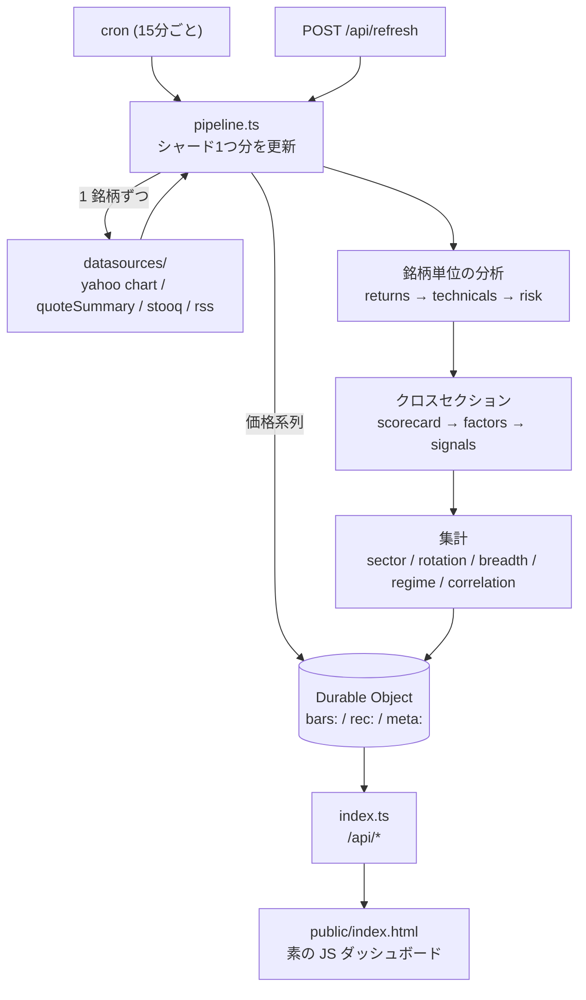

# QAIZ — Quantitative Analyst Intelligence Zone

**地域 × セクターの株式を、一流のアナリストが実際に見る指標で横断分析するターミナル。**
Cloudflare Workers 無料プランだけで動きます。API キーは 1 本も要りません。

PER・PBR・EV/EBITDA・ROE・営業利益率・売上成長率・RSI・MACD・ADX・ボリンジャー・
β・最大ドローダウン・VaR/CVaR・アナリスト目標株価 — これらを **銘柄ごとにバラバラに見るのではなく、
セクター内の相対位置に直してから合成** し、地域 × セクターのマトリクスで一望します。

そのうえで **「今どの銘柄を見るべきか」を根拠つきで提案** します。関連銘柄は
「同業」「連動」「分散」「テーマ・供給網」のどれなのかを区別して示し、
すべての専門用語に初心者向けの解説と**落とし穴**を添えています。

PC でもスマートフォンでも同じ情報にアクセスできます (下記「スマホ対応」)。

---

## 何ができるか

### 0. 銘柄アイデア (提案エンジン)

**このツールの中心機能です。** 今の相場の地形を判定し、その地形で機能しやすい戦術を選び、
戦術に合う銘柄を根拠つきで提示します。

設計の原則は 3 つあります。

**① レジーム条件付き — どんな相場でも何かを推す装置にしない**

まず「上昇基調か / ボラはどうか / リスクを取れる地合いか」を判定し、
そこで機能しやすい戦術だけを有効化します。7 つの戦術を常時回すと、
どんな相場でも必ず何か推してしまう装置になるためです。

| 戦術 | 有効になる地形 |
|---|---|
| クオリティ × モメンタム | 上昇基調 かつ ボラが平常以下 |
| ブレイクアウト | 上昇基調 かつ ボラが平常以下 |
| 割安 × 底打ち確認 | 総崩れでない (下降 かつ リスクオフ 以外) |
| 押し目のクオリティ株 | 下降基調でない |
| ディフェンシブ退避 | 下降基調 / 高ボラ / リスクオフ のいずれか |
| 高配当 × 配当余力 | 強い上昇基調ではない |
| レンジの逆張り | 方向感のないレンジ |

レジーム判定が取れていなければ、**候補を 1 件も出しません**。

**② 根拠は必ず実数**

「モメンタムが強い」ではなく「12-1モメンタム +24.1%、200日線から +14.3% 上、ADX 29.1
(+DI 27.4 / -DI 12.8)」と書きます。数字を書けないものは根拠として採用しません。
根拠が 3 本に満たない銘柄は候補から外します。

**③ 反証を必ず添える**

「何が起きたらこの見立ては崩れるか」を書けないアイデアは出しません。

> - 200日線 (382.11) を割ると順張りの前提が崩れる。ここが機械的な撤退ラインになる
> - モメンタム戦略は相場の転換点で最も大きくやられる。指数が下落基調に変わったら真っ先に外す対象
> - 予想PER 31.2倍 はセクター内で割高な部類 (中央値 23.4倍)。成長が続く前提が既に価格に入っている

反証が 2 本書けない銘柄も候補から外します。これがないものは推奨であって分析ではありません。

各アイデアには「平たく言うと」の一段が付き、その戦術が何を狙っていて何が弱点かを
専門用語なしで説明します。

### 0-2. 関連銘柄 — 「関連」を一括りにしない

「関連銘柄」を 1 種類で済ませると使い道が分からなくなります。QAIZ は 6 種類に分けて、
それぞれ**関係の強さ・根拠の実数・その関係が何を意味するか**を添えます。

| 種類 | 何を意味するか | 使い道 |
|---|---|---|
| **同業** | 同じセクターで時価総額が近い | 割高/割安を判断する物差し |
| **連動** | 直近126日の相関が高い | 両方持っても分散にならない (重複ポジションの検出) |
| **分散** | 相関が低い、または負 | 組み合わせると値動きが穏やかになる |
| **similar** | 割安さ・質・勢いの構成が近い | 同じ狙いで買える代替候補 |
| **テーマ** | 供給網・テーマで繋がる | 需要の**波及の順序**が読める |
| **マクロ要因** | 金利・ドル・原油などとの相関 | 何を見張ればいいかが分かる |

相関だけで「関連」と呼ぶと、たまたま同じ時期に上がっただけの銘柄が出てきます。
逆にセクター分類だけだと、実際には連動していない組み合わせを関連と呼んでしまいます。
両方を別のラベルで出して、使い分けは利用者に委ねる設計です。

**テーマ・供給網は `src/config/themes.ts` に手で書いています。** 誰が誰に売っているのか、
どちらが川上なのかはデータから自動では出てこないからです。8 テーマそれぞれに
波及の順序と「このテーマが崩れる条件」を書いてあります。

```
AI データセンター
  1. 設計・GPU    NVDA / AVGO / AMD      … ここの受注が先行指標になる
  2. メモリ       MU / 005930.KS         … GPU 1枚あたりの搭載量が効く
  3. 製造         2330.TW                … 稼働率がそのまま利益率
  4. 製造装置     ASML.AS / 8035.T       … 工場を増やすときに買われる。最も遅れて効く
  5. 電力・冷却   NEE / 6501.T / GE      … 近年ここが制約になり始めた

  崩れる条件: ハイパースケーラーが設備投資計画を下方修正したとき
```

### 0-3. 初心者向け用語解説

38 用語すべてに 4 つを必ず書いています。

- **平たく言うと** 何か (比喩で構わない)
- **高いと** どういう状態か
- **低いと** どういう状態か
- **落とし穴** — その指標だけを見たときに引っかかる典型的な罠

**落とし穴があるのが要点です。** 指標の意味だけを教えると
「PERが低い株を買えばいい」という最悪の学び方をしてしまいます。

> **PBR (株価純資産倍率)**
> 会社が今すぐ解散して資産を全部売り払ったときの取り分に対して、株価が何倍かという指標。
> 1倍なら解散価値と同じ値段。
> ⚠ 落とし穴: PBR 1倍割れは「割安」と言われがちだが、ROE が低いままなら永久に1倍割れの
> ままということが普通にある。必ず ROE とセットで見る。

画面上の用語はタップすると解説が開きます。アイデアが参照する用語キーが実在するかは
テストで検証しているので、タップしても何も出ないという静かな不具合は起きません。

### 0-4. 対照検証 (Fama-French)

**自分の主張を否定できる材料を、主張と同じ画面に置いています。**

QAIZ のスコアに新しい情報があるかを、QAIZ 自身の指標ではなく外部の確立した基準で測ります。

```
r − rf = α + β₁·Mkt + β₂·SMB + β₃·HML + β₄·RMW + β₅·CMA + β₆·Mom + ε
```

市場・規模・バリュー・収益性・投資・モメンタムという既知の 6 ファクターで説明できてしまう
値動きは、こちらが何かを発見したわけではありません。α が有意に正のときだけ、
既知の要因では説明できない部分があると言えます。

データは **Ken French Data Library** (ダートマス大・公式・無料・キー不要)。
ZIP 配布なので `src/datasources/zip.ts` に最小の ZIP リーダーを書いています
(Workers の `DecompressionStream` は gzip/deflate/deflate-raw のみで、ZIP コンテナは展開できない。
コンテナのヘッダだけ自前で読んで、中身は `deflate-raw` に渡す)。

出すのは 2 つです。

- **銘柄単位の帰属** — その銘柄の値動きが 6 ファクターでどこまで説明できるか。個別画面に表示
- **上位群 / 下位群の傾斜** — QAIZ 総合スコアの上位20銘柄と下位20銘柄が、それぞれどのファクターに寄っているか

#### この数字を成績として読んではいけない理由

現時点のスコアで銘柄を選んで過去リターンを測れば、**選択自体が未来を見ている**ので必ず良い数字が出ます。
それは検証ではありません。ここで読めるのは「QAIZ の上位群がどのファクターに傾いているか」という
**性質の記述**であって、成績ではありません。この但し書きは API レスポンスと画面の両方に必ず付きます。

予測力の本当の検証には「その日の時点で何位だったか」の記録が要ります。今は答えを出せませんが、
記録を始めておかないと永遠に出せないので、**日次の point-in-time スコアを積み始めています**
(`storage.ts` の `recordScores`)。60 日ほど溜まれば、その日の順位で選んだ銘柄がその後どうなったかを
アウトオブサンプルで検証できます。現在の蓄積日数は画面に表示されます。

### 1. 地域 × セクター ヒートマップ
米国・日本・欧州・アジアのセクターを、リターン／バリュエーション／ROE／テクニカル／
200日線超え比率など **11 の切り口で切り替えて** 色分け表示。

ヒートスコアは 3ヶ月・1ヶ月リターン、テクニカル合議、200日線超え比率、予想PER を
**地域内で標準化して** 合成しています。地域内で標準化するのは、通貨と市場水準の差を
落とすため。米国と日本を同じ土俵で Z スコアにすると、単に「その年に強かった国」の
順位になってしまいます。

### 2. ファクターモデル (5 ファクター合成)

| ファクター | 中身 | ピア群 |
|---|---|---|
| **バリュー** | 実績/予想PER・PBR・PSR・EV/EBITDA・PEG・FCF利回り・益利回り・配当利回り | セクター内 |
| **クオリティ** | ROE・ROA・ROIC・粗利/営業/純利益率・D/E・ネット有利子負債/EBITDA・流動比率・インタレストカバレッジ | セクター内 |
| **グロース** | 売上成長率・利益成長率・四半期利益成長率・売上3年CAGR・レーティング改定 | セクター内 |
| **モメンタム** | 12-1モメンタム・3ヶ月リターン・52週レンジ位置・テクニカル合議 (直近1ヶ月は**減点**) | ユニバース全体 |
| **低ボラ** | 年率ボラ・最大ドローダウン・下落キャプチャ | ユニバース全体 |

合成は **Z スコアの段階で加重平均** します。0-100 に直してから平均すると分布の端が潰れ、
「全部そこそこ」の銘柄が上位に来てしまうためです。

バリュエーションを必ずセクター内相対にしているのも同じ理由で、PER 12 倍が割安かどうかは
銀行かソフトウェアかで正反対になります。

### 3. テクニカル (合議制)
RSI(14) / MACD(12,26,9) / ボリンジャー(20,2) + %B + バンド幅パーセンタイル + スクイーズ判定 /
ATR(14) / ストキャスティクス(14,3,3) / ADX(14) + ±DI / OBV / MFI(14) / CCI(20) / Williams %R /
ROC(20) / VWAP(20) / 移動平均 5-20-50-100-200 + ゴールデン/デッドクロス + パーフェクトオーダー /
古典・フィボナッチのピボット / **スイング高安のクラスタリングによる支持・抵抗帯** /
**RSI ダイバージェンス検出**。

総合スコアは重み付き合議で、**内訳を全部開示** します。「テクニカル 78 点」だけ出すのではなく、
どの指標が強気でどれが弱気だったかを 1 行ずつ表示します。

### 4. リスク
年率ボラ (20/60/252日)・下方偏差・β・年率α・R²・トラッキングエラー・情報比・
上昇/下落キャプチャ・最大ドローダウン (期間つき)・シャープ・ソルティノ・カルマー・
歴史的 VaR/CVaR (95/99%)・歪度・超過尖度・±2σ超え日数。

β の計算では **日付を突き合わせてから** リターンを取ります。米株と日本株は営業日が違うので、
末尾から n 本ずつ切り出すと祝日のずれで系列が平行移動し、相関が構造的に過小評価されます。

### 5. スクリーナー
40 以上のフィールドを `≥ / ≤ / 範囲 / 取得済 / 欠損` で組み合わせ可能。8 種のプリセット
(ディープバリュー、クオリティ×モメンタム、高配当×配当余力、押し目のクオリティ株、
ブレイクアウト候補、GARP、アナリスト目標乖離、低ボラ・ディフェンシブ) を同梱。

**欠損はどの比較条件にも一致しません。** 「PER 15倍以下」に PER 不明の銘柄が混ざるのは
スクリーニングでいちばん多い事故なので、例外なく除外しています。ソートでも欠損は常に末尾です。

### 6. セクターローテーション (RRG 風)
相対力 (RS-Ratio) と その変化 (RS-Momentum) の 2 軸で、先行 / 失速 / 劣後 / 改善の
四象限に配置。直近 6 点の軌跡つき。

計算式は README と API レスポンスの両方に明記してあります (下記「再現できる計算」)。

### 7. 相場レジーム判定
トレンド (指数 vs 移動平均・ADX・市場の幅)、ボラティリティ (VIX 水準と 52週レンジ内位置)、
リスク選好 (HYG−LQD の信用スプレッド代理・銅/金・小型/大型・ドル指数) を **別々に判定** し、
それぞれの根拠を数値つきで開示。地形に応じた戦術メモも出します。

これは **予測ではなく現状の記述** です。

### 8. 相関構造
相関行列 (直近126日) + 平均ペア相関 + 第1主成分の寄与率 + 相関距離による階層クラスタリング。

10 銘柄持っていてもクラスタが 2 つなら、分散は実質 2 本ぶんしかありません。

### 9. シグナル
テクニカル・バリュエーション・クオリティ・リスク・コンセンサスを横断して 30 種類以上の
シグナルを生成。**全シグナルに実数の根拠が入ります** — 数字の無いシグナルは占いと区別できません。

バリュートラップ警戒 (割安 × 弱いモメンタム)、クオリティ×モメンタムの合致、
高ROE×低レバレッジ、左に厚いテール、抵抗帯への接近 など。

### 10. スマホ対応
情報を削らずにスマートフォンで使えます。列を隠して「モバイル版は簡易表示」にすると、
出先で見たいときに限って必要な数字が無い、という一番困る形になるためです。

| やっていること | なぜ |
|---|---|
| 表は**横スクロール + 先頭列 (銘柄名) 固定** | 40 列の財務データを縦積みカードにすると比較できなくなる。列は残して、名前だけ見失わないようにする |
| 縦スクロールは**ページ側に返す** | 表の中に入れ子のスクロール領域を作ると、指が表の上にあるときページが動かせなくなる |
| チャート・RRG は**一定幅を保って横スクロール** | 幅 390px に 1180 幅のチャートを押し込むと軸ラベルが 5px 相当になり読めない。潰すより送るほうが実用的 |
| 入力欄は **16px 以上** | iOS Safari は 16px 未満の入力にフォーカスすると自動ズームし、画面幅が変わって表がずれる |
| 操作要素は**高さ 40px 以上** | 指で押せない 27px のセレクトが実際に残っていたので、検証スクリプトで機械的に検出している |
| モーダルは**全画面 + 背面スクロール固定** | 背面が動くと、閉じたときに全く違う位置にいる |
| 左右に `env(safe-area-inset-*)` | ノッチ端末で端の文字が欠けないように |
| ホバー前提の表現を `@media (hover:none)` で無効化 | タップ環境で「押したのに何も起きない」ように見えるのを避ける |

レイアウトの列数は**インラインスタイルではなくクラス** (`.cols-3` / `.cols-main-side` など) で持っています。
インラインで書くとメディアクエリから上書きできず、`!important` を撒く羽目になるためです。

ブレークポイントは 1150px (3列→2列) / 860px (→1列) / 640px (スマホ) / 380px (小型) の 4 段階です。

---

## 設計上の約束

このリポジトリが一貫して守っているルールが 3 つあります。

**1. 取れなかった値は `0` ではなく `null`。**
0 は「PER が 0 倍」という意味のある値です。欠損と混ぜた瞬間にランキングが壊れ、
データが無い銘柄が上位に並びます。API も UI も、欠損は `—` として表示します。

**2. 推定値で穴を埋めない。**
Yahoo の crumb 認証が失敗してファンダメンタルズが取れなければ、`fundamentals` は `null` のまま。
それらしい数字を入れたスクリーナーは、無いより有害です。仮定を置いた派生指標
(ROIC の実効税率 25% 仮定など) は、`fieldSources` にその仮定ごと記録されます。

**3. どの数字がどこから来たか開示する。**
個別銘柄画面に「データの出所」パネルがあり、価格ソース (Yahoo / Stooq)、バー数、
最終営業日、ファンダの取得元と基準時刻、フィールド単位の出所が全部見られます。
Stooq は配当調整されていないので、その場合は警告が出ます。

---

## 再現できる計算

「なんとなくそれっぽいチャート」を出さないために、独自定義の指標は式を公開しています。

**ローテーション座標 (Zスコア正規化版 RS-Ratio / RS-Momentum)**

```
RS_t        = 100 × (セクター価格_t / ベンチマーク価格_t)
rsRatio_t   = 100 + 10 × z₁₂₆(RS_t)
rsMomentum_t= 100 + 10 × z₁₂₆(rsRatio_t − rsRatio_{t−10})
```

本家 JdK RS-Ratio は非公開の平滑化を使うため **絶対値は一致しません**。
四象限の意味と軌跡の回転方向は同じです。`GET /api/rotation` のレスポンスにも同じ注記が入ります。

**ヒートスコア / 各種スコア**: Z スコアを ±2.5σ で飽和させて 0-100 に写像。
線形にすると外れ値でスコアが 0/100 に張り付き、中間層の差が消えます。

**Z スコア**: 中央値と MAD (×1.4826) による頑健版 + 上下 5% ウィンザライズ。
バリュエーション指標は PER 4000 倍のような極端値が普通に出るので、
1 銘柄の外れ値でセクター全体の順位が引っくり返らないようにしています。

---

## ユニバース

135 銘柄。地域 × セクターのマトリクスを埋めるように構成しています。

- **セクター代表 ETF** — 米国 17 (XLK/SMH/IGV/XLC/XLY/XLP/XLE/XLF/KBE/XLV/XBI/XLI/ITA/XLB/XLU/XLRE/GLD)、
  日本 12 (TOPIX + NEXT FUNDS 業種別)、欧州 6 (iShares STOXX Europe 600 業種別)
- **代表構成銘柄** — 米国 35、日本 14、欧州・英国 10、アジア 7。
  ETF には PER も ROE も無いので、セクターのバリュエーションは構成銘柄の **中央値** で代表させます
  (平均だと 1 銘柄の高PERで全体が歪みます)
- **ベンチマーク指数** 17 — リスク計測 (β・相関) の基準
- **マクロ** 12 — VIX、米5年/10年金利、ドル指数、原油、金、銅、TLT/HYG/LQD、ドル円、ユーロドル

`src/config/universe.ts` を編集すれば増減できます。テストがシンボル重複・
セクター/地域の定義漏れ・ベンチマークの欠落を検出します。

---

## デプロイ

```bash
npm install
npx wrangler deploy
```

これだけです。KV のネームスペース作成も ID の貼り付けも要りません
(ストレージは Durable Object の SQLite バックエンドで、デプロイ時に自動作成されます)。

初回アクセス時にバックグラウンドで収集が始まります。全銘柄が揃うまで約 2 時間
(15 分ごとに 1 シャード × 8 シャード)。すぐ埋めたいなら `POST /api/refresh?shard=N` を
シャード番号を変えて叩いてください。

### なぜシャード分割するのか

Workers 無料プランは **1 実行あたりのサブリクエストが 50 本**、CPU 時間もミリ秒単位で有限です。
135 銘柄 × (価格 + ファンダ) を毎回取りに行くと確実に超えます。

そこでユニバースを 8 分割し、cron が回るたびに 1 シャードだけ更新します。価格系列は
Durable Object に残るので、更新していない銘柄も相関・ローテーション・ランキングには参加できます。
重い分析 (テクニカル・リスク) を回すのも、その回に取り直した銘柄だけです。

副作用として銘柄ごとに鮮度が変わりますが、これは隠さず `asOf` と `lastBarDate` として
UI にそのまま出しています。予算切れでスキップされた銘柄も
`/api/meta` の `errors` に `budget-skip:` として残ります。

### 設定 (`wrangler.toml` の `[vars]`)

| 変数 | 既定 | 意味 |
|---|---|---|
| `SHARDS` | `8` | ユニバースの分割数。CPU 超過が出るなら増やす |
| `FETCH_BUDGET` | `44` | 1 実行あたりの外部フェッチ上限 (サブリクエスト上限 50 の内側) |
| `FACTOR_WEIGHTS` | value .25 / quality .25 / momentum .25 / growth .15 / lowVol .10 | ファクター合成のウェイト。合計は自動正規化 |
| `SENTIMENT_MODEL` | `@cf/meta/llama-3.1-8b-instruct` | Workers AI のモデル。使えなければ内蔵レキシコンに自動フォールバック |

---

## API

| エンドポイント | 内容 |
|---|---|
| `GET /api/overview` | ダッシュボード初期表示の一式 (レジーム・幅・セクター・ローテーション・相関・上位下位) |
| `GET /api/universe` | ユニバース定義 (地域・セクター・銘柄) |
| `GET /api/sectors?region=US` | 地域 × セクター集計 |
| `GET /api/screener?preset=deep-value` | プリセット実行 |
| `GET /api/screener?f=fundamentals.forwardPE:lte:15&f=risk.beta:lte:1.2&sort=factors.composite:desc` | URL だけで条件を共有できる簡易文法 |
| `POST /api/screener` | JSON クエリ (全機能) |
| `GET /api/presets` | プリセット定義と全フィールド一覧 |
| `GET /api/symbol/{symbol}` | 個別銘柄の全分析 + 同セクターピア |
| `GET /api/compare?symbols=AAPL,MSFT` | 複数銘柄の横並び |
| `GET /api/history/{symbol}?points=300` | 日次 OHLCV |
| `GET /api/rotation?region=US` | ローテーション座標 (計算式の注記つき) |
| `GET /api/breadth` / `GET /api/regime` / `GET /api/correlation` | 市場の幅 / レジーム / 相関 |
| `GET /api/factors?region=US&sector=semis` | ファクターランキング |
| `GET /api/ideas?region=JP&playbook=value-recovery` | 銘柄アイデア (レジーム判定・有効な戦術・候補・免責つき) |
| `GET /api/benchmark` | Fama-French による対照検証 (α・t値・ファクター傾斜・但し書き) |
| `GET /api/related/{symbol}` | 関連銘柄 (種類別) + 所属テーマ |
| `GET /api/glossary` / `GET /api/glossary?key=priceToBook` | 用語解説 (全件 / 1件) |
| `GET /api/themes` | テーマ・供給網の定義 |
| `GET /api/news` / `GET /api/meta` / `GET /api/health` | ニュース / 取得状態 / ヘルスチェック |
| `POST /api/refresh?shard=N&full=1` | パイプライン手動実行 |

### スクリーナー POST の例

```bash
curl -X POST https://<your-worker>/api/screener \
  -H 'Content-Type: application/json' \
  -d '{
    "regions": ["US", "JP"],
    "filters": [
      { "field": "fundamentals.priceToBook", "op": "lte", "value": 1.2 },
      { "field": "fundamentals.returnOnEquity", "op": "gte", "value": 0.1 },
      { "field": "technicals.ma.above.sma200", "op": "eq", "value": true }
    ],
    "sort": [{ "field": "factors.value", "dir": "desc" }],
    "limit": 50
  }'
```

---

## データソース

すべてキー不要・無料です。

| ソース | 用途 | 備考 |
|---|---|---|
| Yahoo Finance `/v8/finance/chart` | 日次 OHLCV | 認証不要。**配当・分割調整後 (adjclose)** を使い、高安始値も同じ比率で揃える |
| Yahoo Finance `/v10/finance/quoteSummary` | PER/PBR/ROE/アナリスト予想 | cookie + crumb が必要。セッションは 6 時間キャッシュ。失敗時は `null` のまま続行 |
| Stooq CSV | 価格のフォールバック | 配当調整なし。使った場合は警告を出す |
| RSS 8 本 | ニュース / センチメント材料 | Yahoo Finance・CNBC・MarketWatch・NHK 経済・ロイター・Cointelegraph |
| Ken French Data Library | Fama-French 6 ファクターの日次リターン | 公式・無料・キー不要。ZIP 配布なので自前の ZIP リーダーで展開。週1回のみ取得 |
| Cloudflare Workers AI | セクターのニュースセンチメント | 無料枠 10k Neurons/日。枠切れ時は内蔵レキシコンに自動フォールバック |

---

## 作り方 — アーキテクチャと実装

ここから下は「このリポジトリをどう組み立てたか」の解説です。
同じものを作りたい人、中身を変えたい人向け。

### 全体像



要点は 3 つです。

1. **収集と分析を分けない**。1 回の cron 実行で「取る → 数値にする → 保存する」まで完結させ、
   API 側は保存済みの結果を返すだけにします。API リクエストのたびに指標を計算すると、
   Workers の CPU 時間に載りません。
2. **全銘柄を毎回は取らない**。ユニバースを 8 分割し、1 回で 1 シャードだけ更新します。
3. **銘柄単位の分析とクロスセクションを明確に分ける**。前者は 1 銘柄の価格系列だけで決まり、
   後者はピア群が揃わないと計算できません。この境界を曖昧にすると、
   「1 銘柄だけ再計算したら順位が壊れた」という事故が起きます。

### ディレクトリ構成

```
src/
  index.ts              ルーティング。/api/* の入口
  pipeline.ts           収集 → 分析 → 集計 → 保存のオーケストレーション
  storage.ts            Durable Object 本体と、そのクライアント
  types.ts              全レイヤーが参照する型定義

  config/
    universe.ts         135 銘柄の定義とシャード分割
    sectors.ts          セクター / 地域のメタ情報
    themes.ts           テーマ・供給網 (波及の順序を手で記述)
    glossary.ts         用語解説 38 項目 (意味・高い・低い・落とし穴)
    index.ts            バージョン・RSS フィード・既定値

  datasources/
    http.ts             FetchBudget (サブリクエスト上限の管理) と共通 fetch
    yahoo.ts            OHLCV (chart) と ファンダ (quoteSummary + crumb 認証)
    stooq.ts            価格のフォールバック
    rss.ts              ニュース
    zip.ts              最小の ZIP リーダー (Workers に ZIP 展開が無いため)
    kenfrench.ts        Fama-French ファクター (対照群)

  analytics/
    stats.ts            統計プリミティブ (Zスコア・分位点・相関・回帰)
    returns.ts          リターン計算と日付整合
    technicals.ts       テクニカル指標 20 種以上
    risk.ts             ボラ・β・ドローダウン・VaR
    fundamentals.ts     スコアカード (バリュー/クオリティ/グロース)
    factors.ts          5 ファクター合成
    signals.ts          シグナル生成
    related.ts          関連銘柄 (6 種の関係を強度・根拠つきで算出)
    ideas.ts            銘柄アイデア (レジーム条件付きの戦術選択と候補生成)
    regression.ts       多変量OLS (逆行列・t値・R²)
    attribution.ts      Fama-French 帰属 (銘柄単位 / 群の傾斜)
    screener.ts         フィルタ・ソート DSL とプリセット
    aggregate.ts        地域 × セクター集計
    rotation.ts         RRG 座標
    breadth.ts          市場の幅
    regime.ts           レジーム判定
    correlation.ts      相関行列・主成分・クラスタ

  ai/sentiment.ts       Workers AI + レキシコンのフォールバック

public/index.html       ダッシュボード (ビルド不要の素の HTML/CSS/JS 1 ファイル)
dev/mock-server.mjs     UI 確認用のモック API サーバー
test/                   107 テスト
```

依存の向きは常に **上から下** です。`analytics/` は `datasources/` を知らず、
`datasources/` は `analytics/` を知りません。両者を繋ぐのは `pipeline.ts` だけです。
この分離のおかげで、分析ロジックのテストはネットワークを一切必要としません。

### 1 銘柄が数値になるまで

`AAPL` を例に、`pipeline.ts` が何をするか順に追います。

```
1. fetchYahooChart("AAPL")
     → adjclose の調整比率を高安始値にも掛けて Bar[] にする
     → 失敗したら fetchStooqDaily でフォールバック (配当調整なしを警告として記録)

2. computePriceSummary(bars)
     → 1日/1週/1ヶ月/3ヶ月/6ヶ月/12ヶ月/年初来リターン、52週レンジ位置、
       12-1モメンタム (直近1ヶ月を除いた12ヶ月)

3. computeTechnicals(bars)
     → RSI/MACD/ボリンジャー/ATR/ストキャス/ADX/OBV/MFI/CCI/%R/ROC/VWAP/
       移動平均/ピボット/支持抵抗/ダイバージェンス
     → 各指標を強気・弱気・中立に落として重み付き合議 → 0-100 の総合スコア
     → 合議の内訳 (どの指標がどう効いたか) を breakdown として保持

4. computeRisk(bars, benchmarkBars)
     → まず日付を突き合わせてから対数リターンを取る
     → ボラ・β・α・R²・キャプチャ・最大DD・シャープ・VaR/CVaR・歪度・尖度

5. fetchYahooQuoteSummary("AAPL")   ← 個別株のみ。ETF/指数はスキップ
     → PER/PBR/ROE/利益率/成長率/アナリスト目標株価/レーティング分布
     → deriveFundamentals() で益利回り・FCF利回り・ROIC 等を導出し、
       仮定を fieldSources に記録
```

ここまでが**銘柄単位**。この時点ではまだスコアは付きません。

### クロスセクションの順序 (ここが一番効く)

`applyCrossSection()` は必ずこの順で回します。順序を変えると結果が変わります。

```
① セクター単位でスコアカードを作る
     同一セクターのピア群で PER/PBR/ROE 等を頑健Zスコア化 (中央値 + MAD)
     → バリュー / クオリティ / グロースの 0-100 スコア
     ピアが 6 銘柄未満のセクターは、全銘柄をピアにフォールバック
     (3 銘柄で Z を取ると「3位だから最下位」という無意味なスコアになる)

② ユニバース全体でファクターを合成
     ①で既にセクター内相対になっている value/quality/growth と、
     ユニバース全体で標準化する momentum/lowVol を、
     **Zスコアの段階で**加重平均 → composite
     0-100 に直してから平均すると分布の端が潰れ、
     「全部そこそこ」の銘柄が上位に来てしまう

③ シグナルを生成
     ①②が揃ってはじめて「割安なのにモメンタムが弱い = バリュートラップ」
     のような複合判定ができる
```

`coverage` (使えた指標・ファクターの割合) を各段階で返しているのが要点です。
ETF はファンダが原理的に存在せず、勢い + 低ボラだけで coverage 0.35 になります。
個別株の 1.0 と同じ土俵で比べていないことを、スコアと必ずセットで開示します。

### Workers の制約とどう折り合ったか

無料プランの制限は 2 つあり、どちらも設計に直接影響します。

**1 実行あたりサブリクエスト 50 本** — 135 銘柄 × (価格 + ファンダ) では話になりません。

- `FetchBudget` が消費数を数え、上限に達したら**理由を記録して**止まります。
  黙って諦めると「なぜこの銘柄だけ古いのか」が追えなくなるためです。
- スキップされた銘柄は `/api/meta` の `errors` に `budget-skip:` として残ります。
- シャードは `priority` 順に安定ソートしてからラウンドロビンで割ります。
  こうしないと「シャード 7 だけ全部マイナー銘柄」という偏りが出ます。

**CPU 時間がミリ秒単位** — 全銘柄の重い分析を毎回やり直すと超えます。

- 重い分析 (テクニカル・リスク) は**その回に取り直した銘柄だけ**。
  他は Durable Object に残っている前回の結果を使い回します。
- クロスセクションはスカラー値しか触らないので毎回全銘柄に対して回せます。
- 窓ごとに `stdev()` を呼び直す O(n·window) のループは、和と二乗和のローリングで
  O(n) に落としてあります (`bollingerSeries` と `rollingZ`)。

副作用として銘柄ごとに鮮度が変わりますが、これは隠さず `asOf` と `lastBarDate` として
UI にそのまま出しています。

### 永続化のかたち

Durable Object の 1 値あたり上限は 128 KiB です。全銘柄を 1 つの JSON にすると軽く超えるので、
3 種類に分けています。

| キー | 中身 | なぜ分けるか |
|---|---|---|
| `meta:v1` | 集計・レジーム・相関・ニュース | 1 回の読み出しで概況が描ける |
| `rec:<symbol>` | 銘柄 1 本の分析結果 | 1 値のサイズ上限に収める |
| `bars:<symbol>` | 価格系列 (タプル配列に圧縮) | 更新していない銘柄も横断分析に参加させる |
| `session:yahoo` | crumb セッション | 6 時間キャッシュ (毎回 2 リクエスト使うのは無駄) |
| `cursor:v1` | 次に更新するシャード番号 | cron 実行間で持ち回る |

`bars:` は `[t, o, h, l, c, v]` のタプル配列にして JSON サイズを 1/3 程度に抑えています。

### ダッシュボードの作り

ビルドステップはありません。`public/index.html` 1 ファイルに HTML / CSS / JS が入っています。
理由は、Workers の静的アセットにそのまま置けること、そして
**分析ロジックがサーバ側に閉じているので、フロントは表示だけで済む**ことです。

- チャート・RRG・相関ヒートマップはすべて**手書きの SVG**。ライブラリは 1 つも使っていません
  (CSP を厳しく保てて、バンドルサイズもゼロ)
- `table()` が汎用のソート可能テーブルを作ります。行データは 2 つの形
  (スクリーナーのフラットキー / 集計オブジェクトの入れ子) が来るので、
  キーをそのまま引いてから階層パスにフォールバックします
- 欠損は必ず `—` として描画します。`0` と見分けが付かない表示にはしません

### UI をどう検証するか

ダッシュボードは実データが無いと何も描画しないので、モック API を同梱しています。

```bash
npm run dev:mock     # http://127.0.0.1:8787
```

`public/index.html` をそのまま配信し、`/api/*` に固定のダミー JSON を返します。
外部 API にも Cloudflare にも触らないので、ネットワークが無くても
レイアウト・スマホ表示・モーダルの挙動を確認できます。

フィクスチャは**意図的に手書き**です。本体のコードを import して生成すると、
壊れた実装でも「動いているように見える」モックができてしまいます。
型を変えたら `dev/mock-server.mjs` も手で追随させてください。

実際、このモックでブラウザを 390px 幅で開いて、以下 2 件の実バグが見つかっています。

- スクリーナー結果表の数値列が**全部空**だった
  (`/api/screener` は `"factors.composite"` というドット込みのフラットキーで返すのに、
  テーブル側がドットを階層パスとして辿っていた)
- マクロ表の行が `cursor:pointer` なのにタップしても無反応だった
  (クリックハンドラを張るコードが「TR は別で処理済み」として全 TR を除外していた)

### 提案エンジンの組み立て順

アイデア生成は、それより前の全レイヤーが揃っていないと成立しません。依存はこの順です。

```
価格 → テクニカル/リスク → スコアカード → ファクター → シグナル
                                                    ↓
                                    レジーム判定 ────┤
                                                    ↓
                              関連銘柄 ──→ 銘柄アイデア
```

- **レジーム判定より前にアイデアを作れない**。どの戦術が有効かがレジームで決まるため
- **関連銘柄はファクターより後**。ファクター双子の算出に 5 ファクターのスコアが要る
- 関連銘柄の算出は**相関を伴うので、その回に取り直した銘柄だけ**に限定している。
  全銘柄と総当たりすると 135×135 の相関計算になり、Workers の CPU 予算に載らない。
  比較相手も「同セクター + セクター代表 + マクロ + 同じテーマの銘柄」に絞っている

戦術を足すなら `src/analytics/ideas.ts` の `PLAYBOOKS` に 1 つ追加します。
`fits` (どの地形で有効か)、`eligible` (足切り)、`score`、`thesis` (数値を伴う根拠)、
`evidence` の 5 つが必須で、反証は `buildRisks()` に戦術固有の分岐を足します。
根拠 3 本・反証 2 本を満たさない候補は自動的に落ちるので、
中途半端な戦術を足しても候補が出ないだけで、既存の品質は下がりません。

### 拡張のしかた

| やりたいこと | 触る場所 |
|---|---|
| 銘柄を増やす | `src/config/universe.ts`。テストが重複・定義漏れ・ベンチマーク欠落を検出します |
| テクニカル指標を足す | `src/analytics/technicals.ts` に系列関数を書き、`computeTechnicals` の合議に重み付きで加える |
| バリュエーション指標を足す | `src/analytics/fundamentals.ts` の `VALUATION_METRICS` に 1 行足す。定義域 (`domain`) を必ず書く |
| ファクターの重みを変える | `wrangler.toml` の `FACTOR_WEIGHTS`。合計は自動正規化されます |
| スクリーナーのプリセットを足す | `src/analytics/screener.ts` の `PRESETS` |
| シグナルを足す | `src/analytics/signals.ts`。**実数の根拠を `detail` に必ず書く** |
| 提案の戦術を足す | `src/analytics/ideas.ts` の `PLAYBOOKS` と `buildRisks()` |
| テーマ・供給網を足す | `src/config/themes.ts`。テストが銘柄のユニバース存在を検証します |
| 用語解説を足す | `src/config/glossary.ts`。**落とし穴 (`trap`) は必須** — テストが検証します |

銘柄を増やすと 1 シャードあたりのフェッチ数が増えます。
サブリクエスト上限に当たるようなら `SHARDS` を増やしてください。

### ゼロから作るなら

この順で積むと、各段階で動くものが残ります。

1. `types.ts` と `config/universe.ts` — 何を扱うかを先に固定する
2. `analytics/stats.ts` + テスト — ここが全部の土台。欠損の扱いを最初に決める
3. `datasources/yahoo.ts` (chart のみ) — 価格が取れれば以降は全部オフラインで書ける
4. `analytics/technicals.ts` + `risk.ts` + テスト — **既知の参照値と照合する**
5. `pipeline.ts` (銘柄単位まで) + `storage.ts` — ここで一度デプロイして動作確認
6. `datasources/yahoo.ts` に quoteSummary を追加 — crumb 認証は失敗しうる前提で書く
7. `fundamentals.ts` → `factors.ts` → `signals.ts` — クロスセクションはこの順でしか組めない
8. `aggregate.ts` / `rotation.ts` / `regime.ts` / `correlation.ts` — 集計は最後
9. `index.ts` で API を生やし、`public/index.html` を書く

---

## 開発

```bash
npm run dev        # ローカル (wrangler dev)
npm run dev:mock   # モック API でダッシュボードだけ確認 (ネットワーク不要)
npm run typecheck  # 本体 + テストの型検査
npm test           # 144 テスト
```

テストは Node のネイティブ型ストリッピングで `.ts` を直接実行します (Node 22.18+)。

数値ロジックは合成データではなく **既知の参照値** で検証しています。
たとえば RSI(14) は Wilder の標準系列に対する手計算値 (70.4641…) と一致することを確認し、
広く引用される 70.53 との 0.07 のズレが元データの丸め由来であることまでテストのコメントに残しています。

---

## 免責

投資助言ではありません。データは非公式 API 由来で、正確性・完全性・適時性のいずれも保証されません。
シグナルは「観測された事実とその解釈」であって、売買推奨ではありません。

## ライセンス

MIT
