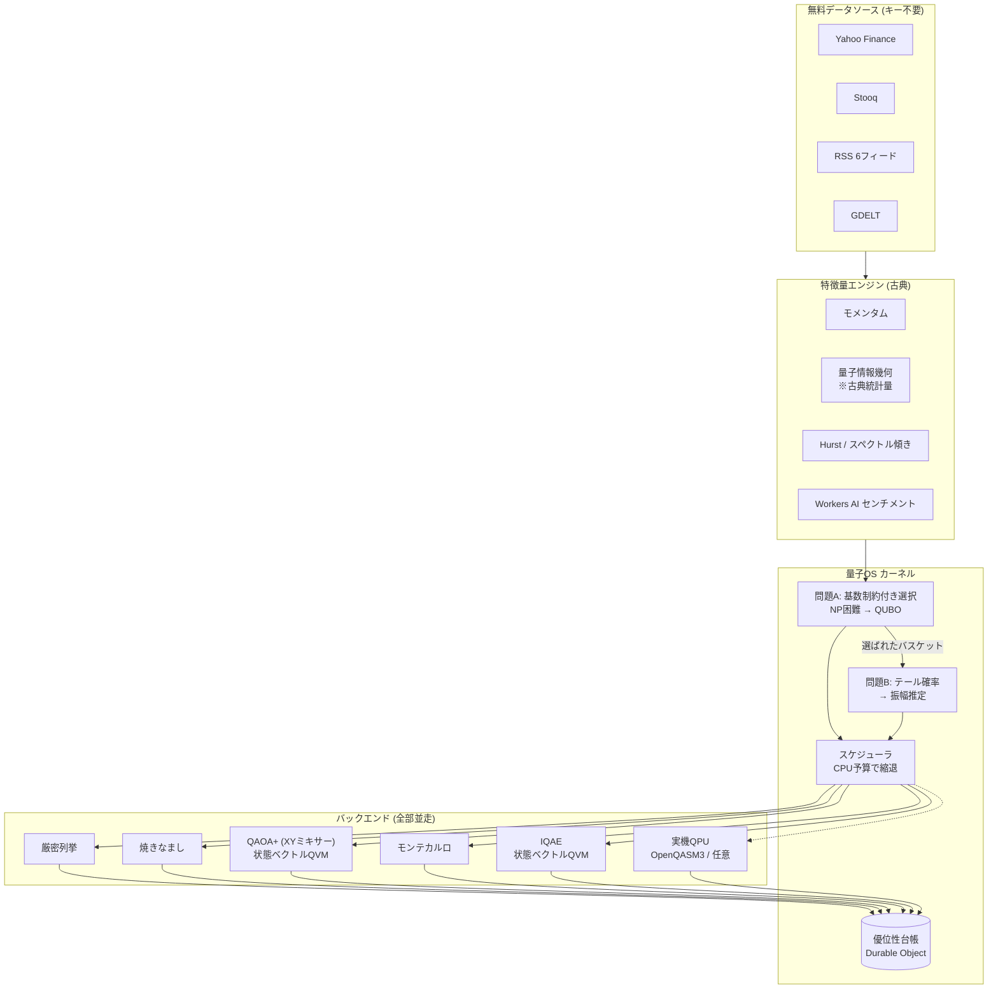

# QAIZ — Quantum Advantage Instrumentation Zone ⚛️📈

**「量子OSを積む実利は何か」に、毎時ライブデータで答え続けるオープンソース・クオンツ基盤。**

セクターの魅力度を並べるだけでなく、**計算量的に難しい問題を実際に解いて意思決定を出す**。
そのうえで、量子バックエンドが古典に勝ったのか負けたのかを **測って台帳に残す**。

**運用コスト: 0円。** すべて無料枠・キー不要API。量子計算は依存ゼロの自前 QVM (TypeScript) で
Cloudflare エッジ上で動く。

---

## まず、正直な話から

v0.1 の QAIZ は「量子」を名乗っていたが、**量子計算は一切していなかった**。

`src/engine/quantumGeometry.ts` がやっていたのは、リターン列を単位ベクトルに正規化して
内積を取り `arccos(√F)` を計算すること。名前は Fubini-Study 距離だが、**中身は O(n) の古典統計量**で、
量子コンピュータに載せる意味も余地もない。そもそも QAIZ が解いていた問題 (加重和でスコアを作る)
に計算量的な難しさが無く、**量子を挿す場所が原理的に存在しなかった**。

v0.2 はここを構造から作り直した。

1. **難しい問題を作る** — QAIZ の出力を「ランキング」から「実際に持つバスケット + その尾リスク」に変えた。
   これで NP困難な組合せ最適化と、確率推定という 2 つの計算課題が必ず経路上に現れる。
2. **本物の量子計算を実装する** — 状態ベクトル QVM、QAOA+ (XYミキサー)、
   反復量子振幅推定 (IQAE)、OpenQASM3 出力、実機 QPU アダプタ。
3. **勝敗を測る** — 全問題を古典バックエンドと量子バックエンドで並走させ、
   クエリ計算量と解の品質で比較して台帳に記録する。**負けも記録する。**

なお `quantumGeometry.ts` は**特徴量として残してある**。市場レジームの指標としては機能するし、
実際にヒートスコアに効いている。ただし v0.2 では **優位性の主張には一切使っていない** — それは古典統計量だからだ。

---

## 量子の出番がある問題 2 つ

### 問題 A: 基数制約付きセクターバスケット選択 (NP困難)

```
maximize   μᵀx − λ xᵀΣx
subject to |x| = K,  x ∈ {0,1}ⁿ
```

μ はヒートスコア、Σ は実現共分散、K は実際に持つ本数。
基数制約付き平均分散最適化は **NP困難** (二次ナップサック / k-densest subgraph を含む)。
連続緩和して丸めても最適解には届かない。量子アニーリング・QAOA が最初に狙った問題クラスそのもの。

**量子経路**: QAOA+ (Hadfield et al. 2019) — XY リングミキサー + Dicke 初期状態。
ハミング重みが保存されるので、**基数制約を満たす部分空間から一歩も出ない**。
ペナルティ方式 (X ミキサー) も実装してあるが、制約違反状態がエネルギーレンジを支配して
γ の分解能が潰れるため、実測でも明確に解が悪い。

**優位性の現状**: **無い。** n=16 なら候補は 4,368 通りで、厳密列挙が 1ms で終わる。
QAOA+ が最適解に届いてもそれは「厳密解の再現」でしかない。QAIZ はこれを隠さず、
毎回厳密解を並走させて近似比を台帳に書く。

### 問題 B: バスケットのテールリスク推定 (二次高速化が証明済み)

```
a = P[ 1日損失 ≥ VaR閾値 ]
```

これは確率推定であり、量子振幅推定が **漸近的な二次高速化を証明済み** の問題クラス:

| | 必要クエリ数 |
|---|---|
| 古典モンテカルロ | **Θ(1/ε²)** (Hoeffding / 中心極限定理の壁) |
| 量子振幅推定 | **O(1/ε)** (Brassard-Høyer-Mosca-Tapp 2002) |

**量子経路**: 反復量子振幅推定 (Grinko-Gacon-Zoufal-Woerner 2021)。
教科書的な QAE は位相推定レジスタで量子ビットを大量に食うが、IQAE は追加量子ビット無しで
同じ O(1/ε) を達成する。NISQ 機で現実味がある唯一の構成。

**実務的な意味**: リスク計測は「精度を1桁上げるとサンプルが100倍」というコスト構造で、
日中の再計算頻度が精度に直接縛られている。二次高速化はこの縛りを「10倍」に変える。

**優位性の現状**: **クエリ計算量では測定済みで優位。** 下の実測表を参照。

---

## 実測: 二次高速化は本当に出ているか

`npm run bench` の出力そのまま (seed 固定・再現可能):

| ε | 古典 必要サンプル Θ(1/ε²) | IQAE オラクル呼び出し O(1/ε) | 比 | IQAE 誤差 |
|---:|---:|---:|---:|---:|
| 0.04 | 1,153 | 400 | ×2.88 | 0.00777 |
| 0.02 | 4,612 | 2,200 | ×2.10 | 0.00401 |
| 0.01 | 18,445 | 2,200 | ×8.38 | 0.00401 |
| 0.005 | 73,778 | 4,900 | ×15.06 | 0.00086 |
| 0.0025 | 295,111 | 13,400 | ×22.02 | 0.00012 |

**比の log-log 回帰の傾き = 0.871** (理論値 1.0)。
精度を上げるほど量子側が有利になっていく — これが Θ(1/ε²) と O(1/ε) の差そのもの。

組合せ最適化側は、同じベンチで **勝てていないこと** が出る:

| n | K | 候補数 | 厳密 (ms) | SA (ms) | QAOA+ (ms) | SA 近似比 | QAOA+ 近似比 |
|---:|---:|---:|---:|---:|---:|---:|---:|
| 12 | 4 | 495 | 0.0 | 8.0 | 41.0 | 1.0000 | 1.0000 |
| 14 | 5 | 2,002 | 0.0 | 10.0 | 153.0 | 1.0000 | 1.0000 |
| 16 | 5 | 4,368 | 1.0 | 19.0 | 319.0 | 1.0000 | 1.0000 |

(実行時間はマシン依存。近似比と候補数は seed 固定で再現する)

QAOA+ は最適解に到達しているが、**厳密解が 1ms で出る領域に優位性は無い**。
厳密列挙が 10⁹ 候補を超えるのは K=10 で n≈41 から。そこが本来の勝負どころだが、
状態ベクトルシミュレータも同時に破綻する。**検証には実機が要る** — QAIZ が QPU アダプタを
持っているのはそのためであって、飾りではない。

### 何を優位性として計上し、何を計上しないか

台帳 (`src/os/ledger.ts`) が構造的に強制している原則:

**計上する**
- **クエリ計算量** — オラクル呼び出し数 / サンプル数。実装非依存で、ハードウェアに載せ替えても引き継がれる量。
- **解の品質** — 厳密解が出る規模では近似比 `(E_worst − E_achieved)/(E_worst − E_optimum)`。

**計上しない**
- **シミュレータの壁時計時間** — 状態ベクトルは 2ⁿ なので、必ず古典に負ける。速く見えたらそれはバグ。
- **「量子的な」名前がついた古典統計量** — Fubini-Study 距離、QFI 近似など。

判定は 3 値しか取らない: `query-model` (測定済みの優位) / `none` (優位なし・理由付き) / `unverified` (厳密解が無いので断定不可)。

---

## 量子OS の中身



### 層構成

| 層 | ファイル | 中身 |
|---|---|---|
| QVM | `src/quantum/statevector.ts` | 状態ベクトルシミュレータ (最大22量子ビット)、任意1量子ビットゲート・多重制御・対角ユニタリ・測定 |
| 〃 | `src/quantum/sector.ts` | ハミング重み保存セクタに限定したシミュレータ。n=16,K=6 で 65,536 → 8,008 次元 (8.2倍削減) |
| 〃 | `src/quantum/circuit.ts` | 回路IR、資源見積り (CX換算・深さ)、逆回路、OpenQASM3 出力 |
| アルゴリズム | `src/quantum/qaoa.ts` | QAOA+ (X / XY ミキサー)、Dicke 状態、CVaR 目的関数、Nelder-Mead |
| 〃 | `src/quantum/iqae.ts` | 反復量子振幅推定、Grover 演算子、Chernoff 信頼区間 |
| 〃 | `src/quantum/stateprep.ts` | 一様制御RYによる厳密な分布ロード、閾値オラクル |
| 問題 | `src/problems/basket.ts` | 基数制約付き平均分散 → QUBO |
| 〃 | `src/problems/tailrisk.ts` | ヒストグラム → 振幅推定インスタンス |
| OS | `src/os/kernel.ts` | ジョブ実行、予算配分、判定 |
| 〃 | `src/os/backends.ts` | 厳密列挙 / 焼きなまし / QAOA |
| 〃 | `src/os/ledger.ts` | 優位性台帳と判定ロジック |
| 〃 | `src/os/qpu.ts` | 実機 QPU アダプタ (未設定なら明示的に unavailable) |

### 設計上の判断メモ

- **XY ミキサーを本命にした理由**: 基数制約をペナルティで表すと、制約違反状態がエネルギーレンジの
  大半を占める。正規化後の実行可能解の幅が数百分の一に潰れ、γ の有効レンジが消える。
  XY ミキサー + Dicke 状態なら制約は保存則として満たされ、漏れは厳密に 0。
- **CVaR 目的関数**: QAOA は「良い解を確率的に含む分布」を作る器であって平均を下げる器ではない。
  浅い回路では CVaR_α の方が圧倒的に速く良解へ寄る (Barkoutsos et al. 2020)。
- **セクタ限定シミュレーション**: XY ミキサーと対角コストはどちらも粒子数を保存するので、
  2ⁿ 次元を持ち歩く理由が無い。これが無いとエッジの CPU 予算に収まらなかった。
  完全な状態ベクトルとの一致はテストで固定 (`test/qaoa.test.ts`)。
- **不透明命令を隠さない**: Dicke 状態生成と整数コンパレータは等価回路を明示展開していない。
  該当する回路は OpenQASM3 出力で `complete: false` を返し、**実機には投げない**。
  「投げられるふりをして黙って壊れる」より明示的に落ちる方がよい。

---

## 監視対象と出力

- **セクターETF 16種** (XLK/SMH/XLF/XLE/XLV/XLI/XLY/XLP/XLU/XLB/XLRE/XLC/GLD/ARKX/BTC/TOPIX)
- **世界12指数**、**ニュース** (RSS 6フィード + GDELT)
- **出力**: ヒートランキング + **K本のバスケット** + **その VaR / CVaR / テール確率** + **優位性台帳**

## API

| エンドポイント | 内容 |
|---|---|
| `GET /api/snapshot` | 全データ (セクター/指数/ニュース/量子OS出力) |
| `GET /api/sectors` | セクターヒートランキング |
| `GET /api/indices` | 世界指数クオート |
| `GET /api/news` | 収集ニュース |
| `GET /api/basket` | 量子OSが選んだバスケットと尾リスク |
| `GET /api/quantum/status` | OS構成・問題定義・バックエンド一覧・実機QPUの接続状態 |
| `GET /api/quantum/ledger` | 優位性台帳 (直近200件の実測履歴) |
| `POST /api/quantum/solve` | 任意の問題をその場で全バックエンド横並びで解く |
| `POST /api/refresh` | パイプライン手動実行 |
| `GET /api/health` | ヘルスチェック |

`POST /api/quantum/solve` は μ と Σ の元データを呼び出し側から渡せる。
**優位性の主張を第三者が再現できるようにするため** — 市場データ由来の数字だけ見せて
「量子が効いた」と言うのは検証不能だからだ。

```bash
curl -X POST https://qaiz.<サブドメイン>.workers.dev/api/quantum/solve \
  -H 'Content-Type: application/json' \
  -d '{"returns": [[0.01,-0.02,...], ...], "cardinality": 4, "epsilon": 0.005}'
```

## デプロイ (5分・0円)

```bash
npm install
npx wrangler login
npx wrangler deploy
```

ストレージは Durable Object (SQLite) なのでデプロイ時に自動作成される。ID の手動設定は無い。

### CPU 予算について

状態ベクトルシミュレーションは指数コストなので、`wrangler.toml` の `QUANTUM_BUDGET_MS`
(既定 120ms) で必ず上限を切っている。予算を超えたバックエンドは実行されず、
**その理由が台帳に残る**。Workers 無料プランで CPU 超過が出るようなら 30 程度まで下げてよい —
QAOA は Nelder-Mead の反復数を落として自動で縮退し、それでも実行可能解は返す。

### 実機 QPU (任意)

```bash
npx wrangler secret put QPU_ENDPOINT   # OpenQASM3 を受け付ける HTTP エンドポイント
npx wrangler secret put QPU_TOKEN
npx wrangler secret put QPU_BACKEND    # 例: ibm_brisbane
```

未設定でも全機能が動く。設定していない場合、台帳には「実機は未設定」と明示的に記録される
(ダミー結果は返さない)。

### ローカル開発

```bash
npm run dev        # http://localhost:8787
curl -X POST http://localhost:8787/api/refresh

npm test           # 184 テスト (数理エンジン + QVM + QAOA + IQAE + 問題 + OS)
npm run typecheck  # tsc --noEmit (src / test / bench)
npm run bench      # 優位性ベンチマーク (README の表を再生成する)
```

テストランナーは Node 標準の `node:test` で **追加の依存はゼロ**。
`.ts` をネイティブの型ストリッピングで直接実行するため **Node 22.18 以上**が必要。

テストで固定している主な性質:

- **QVM**: Bell/GHZ 状態、ユニタリ性 (ノルム保存)、リトルエンディアン規約、逆回路、資源見積り
- **Grover 演算子**: `p_k = sin²((2k+1)θ)` を **1e-12 の精度で** 再現すること
- **振幅ロード**: 測定確率が元の分布と 1e-12 で一致すること
- **IQAE**: 推定値が ε 以内、信頼区間が真値を含む、**クエリ比が ε を細かくするほど伸びること**
- **QAOA+**: 解が必ず基数制約を満たす、XY ミキサーの漏れが厳密に 0、総当たり最適値への到達
- **セクタシミュレータ**: 完全な状態ベクトルと 1e-13 で一致
- **台帳**: 厳密解が無いときに近似比を捏造しない、古典が勝つときは優位なしと言う
- **QPU アダプタ**: 未設定時にダミー結果を返さない、不透明命令を含む回路を実機に投げない

ネットワークにも Cloudflare にも触らないので、CI は Secret なしで完走する。

## 研究層 (`research/`)

エッジ実装の背景にある数理を Python で検証する PoC 群。詳細は [research/README.md](research/README.md)。

- `quantum_geometry_momentum.py` — PennyLane で量子幾何テンソルを計算し、量子自然勾配法で学習
- `pinn_black_scholes.py` — PINN で Black–Scholes PDE を求解
- `cosmo_spectral_market.py` — CMB解析と同型のスペクトル解析 + Hurst で市場レジームをマップ

## 参考文献

- Brassard, Høyer, Mosca, Tapp, *Quantum Amplitude Amplification and Estimation* (2002)
- Montanaro, *Quantum speedup of Monte Carlo methods* (2015)
- Woerner & Egger, *Quantum risk analysis*, npj Quantum Information 5, 15 (2019)
- Grinko, Gacon, Zoufal, Woerner, *Iterative Quantum Amplitude Estimation* (2021)
- Hadfield et al., *From the Quantum Approximate Optimization Algorithm to a Quantum Alternating Operator Ansatz* (2019)
- Barkoutsos et al., *Improving Variational Quantum Optimization using CVaR* (2020)
- Bärtschi & Eidenbenz, *Deterministic Preparation of Dicke States* (2019)

## ライセンス

[MIT](LICENSE)。フォーク・改変・再配布・商用利用が可能。
`package.json` の `"private": true` は npm レジストリへの誤publish防止フラグであって、
ソースの利用条件とは無関係。ライセンスの正本は `LICENSE` ファイル。

`research/` 配下の Python PoC も同じ MIT。依存ライブラリ (PennyLane / PyTorch 等) は
各々のライセンスに従うこと。

## 免責

本プロジェクトは研究・教育目的です。出力は投資助言ではありません。
量子計算部分は**シミュレータ上の実装**であり、実機での優位性を主張するものではありません
(クエリ計算量の優位は理論とシミュレーションで確認済みですが、実機のノイズ・接続性・
トランスパイル後のゲート数は別問題です)。投資判断は自己責任で行ってください。
