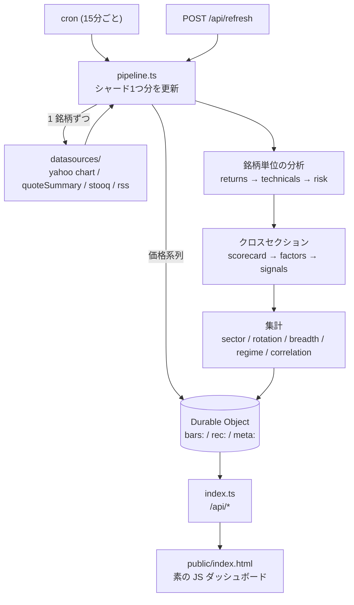

# QAIZ — Quantitative Analyst Intelligence Zone

**地域 × セクターの株式を、一流のアナリストが実際に見る指標で横断分析するターミナル。**
Cloudflare Workers 無料プランだけで動きます。API キーは 1 本も要りません。

PER・PBR・EV/EBITDA・ROE・営業利益率・売上成長率・RSI・MACD・ADX・ボリンジャー・
β・最大ドローダウン・VaR/CVaR・アナリスト目標株価 — これらを **銘柄ごとにバラバラに見るのではなく、
セクター内の相対位置に直してから合成** し、地域 × セクターのマトリクスで一望します。

PC でもスマートフォンでも同じ情報にアクセスできます (下記「スマホ対応」)。

**そしてもう半分**: ダッシュボードが「今」を見せる一方で、
`lab/` に **日本株のクオンツ研究ラボ**があります (Python / ローカル PC / 無料構成)。
Point-in-Time データ管理・リーケージ検出・取引コスト・Walk-Forward 検証・
過適合の定量化まで含めた、**過去を検証するための層**です。

2 つは 3 つの接点で繋がっています → [研究ラボとの統合](#研究ラボとの統合)

---

## 何ができるか

### 1. 地域 × セクター ヒートマップ
米国・日本・欧州・アジアのセクターを、リターン／バリュエーション／ROE／テクニカル／
200日線超え比率など **11 の切り口で切り替えて** 色分け表示。

ヒートスコアは 3ヶ月・1ヶ月リターン、テクニカル合議、200日線超え比率、予想PER を
**地域内で標準化して** 合成しています。地域内で標準化するのは、通貨と市場水準の差を
落とすため。米国と日本を同じ土俵で Z スコアにすると、単に「その年に強かった国」の
順位になってしまいます。

### 2. ファクターモデル (5 ファクター合成)

| ファクター | 中身 | ピア群 |
|---|---|---|
| **バリュー** | 実績/予想PER・PBR・PSR・EV/EBITDA・PEG・FCF利回り・益利回り・配当利回り | セクター内 |
| **クオリティ** | ROE・ROA・ROIC・粗利/営業/純利益率・D/E・ネット有利子負債/EBITDA・流動比率・インタレストカバレッジ | セクター内 |
| **グロース** | 売上成長率・利益成長率・四半期利益成長率・売上3年CAGR・レーティング改定 | セクター内 |
| **モメンタム** | 12-1モメンタム・3ヶ月リターン・52週レンジ位置・テクニカル合議 (直近1ヶ月は**減点**) | ユニバース全体 |
| **低ボラ** | 年率ボラ・最大ドローダウン・下落キャプチャ | ユニバース全体 |

合成は **Z スコアの段階で加重平均** します。0-100 に直してから平均すると分布の端が潰れ、
「全部そこそこ」の銘柄が上位に来てしまうためです。

バリュエーションを必ずセクター内相対にしているのも同じ理由で、PER 12 倍が割安かどうかは
銀行かソフトウェアかで正反対になります。

### 3. テクニカル (合議制)
RSI(14) / MACD(12,26,9) / ボリンジャー(20,2) + %B + バンド幅パーセンタイル + スクイーズ判定 /
ATR(14) / ストキャスティクス(14,3,3) / ADX(14) + ±DI / OBV / MFI(14) / CCI(20) / Williams %R /
ROC(20) / VWAP(20) / 移動平均 5-20-50-100-200 + ゴールデン/デッドクロス + パーフェクトオーダー /
古典・フィボナッチのピボット / **スイング高安のクラスタリングによる支持・抵抗帯** /
**RSI ダイバージェンス検出**。

総合スコアは重み付き合議で、**内訳を全部開示** します。「テクニカル 78 点」だけ出すのではなく、
どの指標が強気でどれが弱気だったかを 1 行ずつ表示します。

### 4. リスク
年率ボラ (20/60/252日)・下方偏差・β・年率α・R²・トラッキングエラー・情報比・
上昇/下落キャプチャ・最大ドローダウン (期間つき)・シャープ・ソルティノ・カルマー・
歴史的 VaR/CVaR (95/99%)・歪度・超過尖度・±2σ超え日数。

β の計算では **日付を突き合わせてから** リターンを取ります。米株と日本株は営業日が違うので、
末尾から n 本ずつ切り出すと祝日のずれで系列が平行移動し、相関が構造的に過小評価されます。

### 5. スクリーナー
40 以上のフィールドを `≥ / ≤ / 範囲 / 取得済 / 欠損` で組み合わせ可能。8 種のプリセット
(ディープバリュー、クオリティ×モメンタム、高配当×配当余力、押し目のクオリティ株、
ブレイクアウト候補、GARP、アナリスト目標乖離、低ボラ・ディフェンシブ) を同梱。

**欠損はどの比較条件にも一致しません。** 「PER 15倍以下」に PER 不明の銘柄が混ざるのは
スクリーニングでいちばん多い事故なので、例外なく除外しています。ソートでも欠損は常に末尾です。

### 6. セクターローテーション (RRG 風)
相対力 (RS-Ratio) と その変化 (RS-Momentum) の 2 軸で、先行 / 失速 / 劣後 / 改善の
四象限に配置。直近 6 点の軌跡つき。

計算式は README と API レスポンスの両方に明記してあります (下記「再現できる計算」)。

### 7. 相場レジーム判定
トレンド (指数 vs 移動平均・ADX・市場の幅)、ボラティリティ (VIX 水準と 52週レンジ内位置)、
リスク選好 (HYG−LQD の信用スプレッド代理・銅/金・小型/大型・ドル指数) を **別々に判定** し、
それぞれの根拠を数値つきで開示。地形に応じた戦術メモも出します。

これは **予測ではなく現状の記述** です。

### 8. 相関構造
相関行列 (直近126日) + 平均ペア相関 + 第1主成分の寄与率 + 相関距離による階層クラスタリング。

10 銘柄持っていてもクラスタが 2 つなら、分散は実質 2 本ぶんしかありません。

### 9. シグナル
テクニカル・バリュエーション・クオリティ・リスク・コンセンサスを横断して 30 種類以上の
シグナルを生成。**全シグナルに実数の根拠が入ります** — 数字の無いシグナルは占いと区別できません。

バリュートラップ警戒 (割安 × 弱いモメンタム)、クオリティ×モメンタムの合致、
高ROE×低レバレッジ、左に厚いテール、抵抗帯への接近 など。

### 10. スマホ対応
情報を削らずにスマートフォンで使えます。列を隠して「モバイル版は簡易表示」にすると、
出先で見たいときに限って必要な数字が無い、という一番困る形になるためです。

| やっていること | なぜ |
|---|---|
| 表は**横スクロール + 先頭列 (銘柄名) 固定** | 40 列の財務データを縦積みカードにすると比較できなくなる。列は残して、名前だけ見失わないようにする |
| 縦スクロールは**ページ側に返す** | 表の中に入れ子のスクロール領域を作ると、指が表の上にあるときページが動かせなくなる |
| チャート・RRG は**一定幅を保って横スクロール** | 幅 390px に 1180 幅のチャートを押し込むと軸ラベルが 5px 相当になり読めない。潰すより送るほうが実用的 |
| 入力欄は **16px 以上** | iOS Safari は 16px 未満の入力にフォーカスすると自動ズームし、画面幅が変わって表がずれる |
| 操作要素は**高さ 40px 以上** | 指で押せない 27px のセレクトが実際に残っていたので、検証スクリプトで機械的に検出している |
| モーダルは**全画面 + 背面スクロール固定** | 背面が動くと、閉じたときに全く違う位置にいる |
| 左右に `env(safe-area-inset-*)` | ノッチ端末で端の文字が欠けないように |
| ホバー前提の表現を `@media (hover:none)` で無効化 | タップ環境で「押したのに何も起きない」ように見えるのを避ける |

レイアウトの列数は**インラインスタイルではなくクラス** (`.cols-3` / `.cols-main-side` など) で持っています。
インラインで書くとメディアクエリから上書きできず、`!important` を撒く羽目になるためです。

ブレークポイントは 1150px (3列→2列) / 860px (→1列) / 640px (スマホ) / 380px (小型) の 4 段階です。

---

## 設計上の約束

このリポジトリが一貫して守っているルールが 3 つあります。

**1. 取れなかった値は `0` ではなく `null`。**
0 は「PER が 0 倍」という意味のある値です。欠損と混ぜた瞬間にランキングが壊れ、
データが無い銘柄が上位に並びます。API も UI も、欠損は `—` として表示します。

**2. 推定値で穴を埋めない。**
Yahoo の crumb 認証が失敗してファンダメンタルズが取れなければ、`fundamentals` は `null` のまま。
それらしい数字を入れたスクリーナーは、無いより有害です。仮定を置いた派生指標
(ROIC の実効税率 25% 仮定など) は、`fieldSources` にその仮定ごと記録されます。

**3. どの数字がどこから来たか開示する。**
個別銘柄画面に「データの出所」パネルがあり、価格ソース (Yahoo / Stooq)、バー数、
最終営業日、ファンダの取得元と基準時刻、フィールド単位の出所が全部見られます。
Stooq は配当調整されていないので、その場合は警告が出ます。

---

## 再現できる計算

「なんとなくそれっぽいチャート」を出さないために、独自定義の指標は式を公開しています。

**ローテーション座標 (Zスコア正規化版 RS-Ratio / RS-Momentum)**

```
RS_t        = 100 × (セクター価格_t / ベンチマーク価格_t)
rsRatio_t   = 100 + 10 × z₁₂₆(RS_t)
rsMomentum_t= 100 + 10 × z₁₂₆(rsRatio_t − rsRatio_{t−10})
```

本家 JdK RS-Ratio は非公開の平滑化を使うため **絶対値は一致しません**。
四象限の意味と軌跡の回転方向は同じです。`GET /api/rotation` のレスポンスにも同じ注記が入ります。

**ヒートスコア / 各種スコア**: Z スコアを ±2.5σ で飽和させて 0-100 に写像。
線形にすると外れ値でスコアが 0/100 に張り付き、中間層の差が消えます。

**Z スコア**: 中央値と MAD (×1.4826) による頑健版 + 上下 5% ウィンザライズ。
バリュエーション指標は PER 4000 倍のような極端値が普通に出るので、
1 銘柄の外れ値でセクター全体の順位が引っくり返らないようにしています。

---

## ユニバース

135 銘柄。地域 × セクターのマトリクスを埋めるように構成しています。

- **セクター代表 ETF** — 米国 17 (XLK/SMH/IGV/XLC/XLY/XLP/XLE/XLF/KBE/XLV/XBI/XLI/ITA/XLB/XLU/XLRE/GLD)、
  日本 12 (TOPIX + NEXT FUNDS 業種別)、欧州 6 (iShares STOXX Europe 600 業種別)
- **代表構成銘柄** — 米国 35、日本 14、欧州・英国 10、アジア 7。
  ETF には PER も ROE も無いので、セクターのバリュエーションは構成銘柄の **中央値** で代表させます
  (平均だと 1 銘柄の高PERで全体が歪みます)
- **ベンチマーク指数** 17 — リスク計測 (β・相関) の基準
- **マクロ** 12 — VIX、米5年/10年金利、ドル指数、原油、金、銅、TLT/HYG/LQD、ドル円、ユーロドル

`src/config/universe.ts` を編集すれば増減できます。テストがシンボル重複・
セクター/地域の定義漏れ・ベンチマークの欠落を検出します。

---

## デプロイ

```bash
npm install
npx wrangler deploy
```

これだけです。KV のネームスペース作成も ID の貼り付けも要りません
(ストレージは Durable Object の SQLite バックエンドで、デプロイ時に自動作成されます)。

初回アクセス時にバックグラウンドで収集が始まります。全銘柄が揃うまで約 2 時間
(15 分ごとに 1 シャード × 8 シャード)。すぐ埋めたいなら `POST /api/refresh?shard=N` を
シャード番号を変えて叩いてください。

### なぜシャード分割するのか

Workers 無料プランは **1 実行あたりのサブリクエストが 50 本**、CPU 時間もミリ秒単位で有限です。
135 銘柄 × (価格 + ファンダ) を毎回取りに行くと確実に超えます。

そこでユニバースを 8 分割し、cron が回るたびに 1 シャードだけ更新します。価格系列は
Durable Object に残るので、更新していない銘柄も相関・ローテーション・ランキングには参加できます。
重い分析 (テクニカル・リスク) を回すのも、その回に取り直した銘柄だけです。

副作用として銘柄ごとに鮮度が変わりますが、これは隠さず `asOf` と `lastBarDate` として
UI にそのまま出しています。予算切れでスキップされた銘柄も
`/api/meta` の `errors` に `budget-skip:` として残ります。

### 設定 (`wrangler.toml` の `[vars]`)

| 変数 | 既定 | 意味 |
|---|---|---|
| `SHARDS` | `8` | ユニバースの分割数。CPU 超過が出るなら増やす |
| `FETCH_BUDGET` | `44` | 1 実行あたりの外部フェッチ上限 (サブリクエスト上限 50 の内側) |
| `FACTOR_WEIGHTS` | value .25 / quality .25 / momentum .25 / growth .15 / lowVol .10 | ファクター合成のウェイト。合計は自動正規化 |
| `SENTIMENT_MODEL` | `@cf/meta/llama-3.1-8b-instruct` | Workers AI のモデル。使えなければ内蔵レキシコンに自動フォールバック |

---

## API

| エンドポイント | 内容 |
|---|---|
| `GET /api/overview` | ダッシュボード初期表示の一式 (レジーム・幅・セクター・ローテーション・相関・上位下位) |
| `GET /api/universe` | ユニバース定義 (地域・セクター・銘柄) |
| `GET /api/sectors?region=US` | 地域 × セクター集計 |
| `GET /api/screener?preset=deep-value` | プリセット実行 |
| `GET /api/screener?f=fundamentals.forwardPE:lte:15&f=risk.beta:lte:1.2&sort=factors.composite:desc` | URL だけで条件を共有できる簡易文法 |
| `POST /api/screener` | JSON クエリ (全機能) |
| `GET /api/presets` | プリセット定義と全フィールド一覧 |
| `GET /api/symbol/{symbol}` | 個別銘柄の全分析 + 同セクターピア |
| `GET /api/compare?symbols=AAPL,MSFT` | 複数銘柄の横並び |
| `GET /api/history/{symbol}?points=300` | 日次 OHLCV |
| `GET /api/rotation?region=US` | ローテーション座標 (計算式の注記つき) |
| `GET /api/breadth` / `GET /api/regime` / `GET /api/correlation` | 市場の幅 / レジーム / 相関 |
| `GET /api/factors?region=US&sector=semis` | ファクターランキング |
| `GET /api/news` / `GET /api/meta` / `GET /api/health` | ニュース / 取得状態 / ヘルスチェック |
| `GET /api/pit/status` | Point-in-Time ジャーナルの蓄積状況 (保持期限の警告つき) |
| `GET /api/pit/export?from=&to=` | PIT ジャーナルの NDJSON エクスポート (研究ラボ用) |
| `POST /api/refresh?shard=N&full=1` | パイプライン手動実行 |

---

## 研究ラボとの統合

ダッシュボードだけでは「この指標は本当に効くのか」に答えられません。
`lab/` (Python) がその答え合わせをします。

```
┌─ QAIZ Worker (TypeScript / Cloudflare 無料枠) ────────────────┐
│  cron 15分 → 取得 → 分析 → Snapshot → 画面                    │
│                  └──► ★ PIT ジャーナル (append-only)          │
└──────────────────────────┬────────────────────────────────────┘
                           │ GET /api/pit/export (NDJSON)
┌──────────────────────────▼────────────────────────────────────┐
│  qaiz_lab (Python / ローカルPC / numpy + pandas のみ)          │
│  PIT結合 → 特徴量 → ラベル → バックテスト → 検証 → 実験ログ     │
└───────────────────────────────────────────────────────────────┘
```

### 接点 1 — PIT ジャーナル (これが統合の理由)

株価は後から取り直せます。2020 年の終値は今日でも取れます。
**しかし「2020 年時点の予想 PER」は、今日どこからも取れません。**

Yahoo が返す `forwardPE` は「今の予想 EPS に基づく今の PER」であって、
当時市場が見ていた予想 PER ではありません。目標株価・レーティング・空売り比率も同じで、
無料で手に入るのは常に「現在」だけ。過去分を買おうとすると有料の PIT データベンダーが要ります。

ところが **この Worker は 15 分ごとの無料 cron でその値を毎回見ています。**
見た瞬間に上書きして捨てていただけで、観測時刻とセットで残せば、
それはそのまま Point-in-Time 観測になります。観測時刻 = `available_at`。

今日から記録すれば 1 年後には 1 年ぶんの履歴になります。
**記録しなかった日は永久に埋まりません。** だから「あとで」ではなく最初に作りました。

記録するのは**再取得できない値だけ** (ファンダ 24 項目 + コンセンサス 7 項目)。
価格・テクニカル・リスク指標は後で再計算できるので記録しません。
1 日 1 観測・先勝ち (上書きすると「もっと早く知っていた」事実が消えるため)。

```bash
curl https://<worker>/api/pit/status                      # 蓄積状況
cd lab && python -m qaiz_lab.cli pit-sync --url https://<worker>   # ローカルに退避
```

### 接点 2 — 計算のパリティ

`src/analytics/stats.ts` と `lab/qaiz_lab/xsection.py` は**同じ数字を出します**。
Z スコア・ウィンザライズ・分位・パーセンタイル順位の定義が一致していることを、
`configs/parity_vectors.json` のゴールデンベクタで**両言語のテストが検査**します。

これが無いと「画面で 72 点の銘柄を、研究では 65 点として検証していた」が起きます。
バックテストで検証したのと違うものを画面で見て売買することになるので、
単なる整合性ではなく安全装置です。片方だけ変更すると CI が落ちます。

### 接点 3 — 共有 config

`configs/*.json` をユニバース規則・コスト仮定の唯一の真実にしています。
JSON にしているのは、TypeScript と Python の**両方が依存なしで読める**唯一の形式だからです。

### ラボ側が何をするか

| | 内容 |
|---|---|
| **PIT** | `available_at <= 判断時刻` の as-of 結合。公表前の数字を使わせない |
| **リーケージ検出** | 切り詰め整合・定数列 broadcast・未来タイムスタンプ・同日約定を自動で弾く |
| **コスト** | 手数料 + ハーフスプレッド + 平方根則インパクト。ADV 不明なら建てない |
| **検証** | IC/ICIR/減衰・分位の単調性・Walk-Forward・Purged CV + embargo |
| **過適合** | Deflated Sharpe Ratio / PBO。試行回数で割り引く |
| **ストレス** | コスト×3・シグナル遅延・欠損注入・パラメータ感度・キャパシティ |
| **実験管理** | 失敗も残す。試行回数を累計して DSR に渡す |

```bash
cd lab && pip install -e ".[dev]"
python -m qaiz_lab.cli doctor
python -m qaiz_lab.cli run --experiment R001 --quick   # 合成データで配管を確認
```

詳細は [`lab/README.md`](lab/README.md)、方針は
[`PROJECT_AUDIT.md`](PROJECT_AUDIT.md) / [`RESEARCH_PROTOCOL.md`](RESEARCH_PROTOCOL.md) /
[`DATA_DICTIONARY.md`](DATA_DICTIONARY.md) にあります。

### いま実データで研究できないもの

最初の本格研究として **Research 001「信用取引残高変化の将来超過リターン予測力」** を
事前登録してありますが、**実データでの実行は開けていません。**

```
1. JPX 銘柄別信用取引週末残高のファイル仕様 (列定義・期間・公表時刻) が未確認
2. J-Quants Free プランで weekly_margin_interest が使えるかが未確認
```

このリポジトリを構築した環境から JPX / J-Quants の公式仕様に到達できず、
一次情報で確認できていません。確認せずに走らせると、列の取り違えで全部 NaN になり
**「信用残に予測力は無かった」という誤った結論が出ます。しかもそれは正しく見えます。**
だから止めてあります (`configs/research/r001_margin.json` の `known_blockers`)。

### スクリーナー POST の例

```bash
curl -X POST https://<your-worker>/api/screener \
  -H 'Content-Type: application/json' \
  -d '{
    "regions": ["US", "JP"],
    "filters": [
      { "field": "fundamentals.priceToBook", "op": "lte", "value": 1.2 },
      { "field": "fundamentals.returnOnEquity", "op": "gte", "value": 0.1 },
      { "field": "technicals.ma.above.sma200", "op": "eq", "value": true }
    ],
    "sort": [{ "field": "factors.value", "dir": "desc" }],
    "limit": 50
  }'
```

---

## データソース

すべてキー不要・無料です。

| ソース | 用途 | 備考 |
|---|---|---|
| Yahoo Finance `/v8/finance/chart` | 日次 OHLCV | 認証不要。**配当・分割調整後 (adjclose)** を使い、高安始値も同じ比率で揃える |
| Yahoo Finance `/v10/finance/quoteSummary` | PER/PBR/ROE/アナリスト予想 | cookie + crumb が必要。セッションは 6 時間キャッシュ。失敗時は `null` のまま続行 |
| Stooq CSV | 価格のフォールバック | 配当調整なし。使った場合は警告を出す |
| RSS 8 本 | ニュース / センチメント材料 | Yahoo Finance・CNBC・MarketWatch・NHK 経済・ロイター・Cointelegraph |
| Cloudflare Workers AI | セクターのニュースセンチメント | 無料枠 10k Neurons/日。枠切れ時は内蔵レキシコンに自動フォールバック |

---

## 作り方 — アーキテクチャと実装

ここから下は「このリポジトリをどう組み立てたか」の解説です。
同じものを作りたい人、中身を変えたい人向け。

### 全体像



要点は 3 つです。

1. **収集と分析を分けない**。1 回の cron 実行で「取る → 数値にする → 保存する」まで完結させ、
   API 側は保存済みの結果を返すだけにします。API リクエストのたびに指標を計算すると、
   Workers の CPU 時間に載りません。
2. **全銘柄を毎回は取らない**。ユニバースを 8 分割し、1 回で 1 シャードだけ更新します。
3. **銘柄単位の分析とクロスセクションを明確に分ける**。前者は 1 銘柄の価格系列だけで決まり、
   後者はピア群が揃わないと計算できません。この境界を曖昧にすると、
   「1 銘柄だけ再計算したら順位が壊れた」という事故が起きます。

### ディレクトリ構成

```
src/
  index.ts              ルーティング。/api/* の入口
  pipeline.ts           収集 → 分析 → 集計 → 保存のオーケストレーション
  storage.ts            Durable Object 本体と、そのクライアント
  types.ts              全レイヤーが参照する型定義

  config/
    universe.ts         135 銘柄の定義とシャード分割
    sectors.ts          セクター / 地域のメタ情報
    index.ts            バージョン・RSS フィード・既定値

  datasources/
    http.ts             FetchBudget (サブリクエスト上限の管理) と共通 fetch
    yahoo.ts            OHLCV (chart) と ファンダ (quoteSummary + crumb 認証)
    stooq.ts            価格のフォールバック
    rss.ts              ニュース

  analytics/
    stats.ts            統計プリミティブ (Zスコア・分位点・相関・回帰)
    returns.ts          リターン計算と日付整合
    technicals.ts       テクニカル指標 20 種以上
    risk.ts             ボラ・β・ドローダウン・VaR
    fundamentals.ts     スコアカード (バリュー/クオリティ/グロース)
    factors.ts          5 ファクター合成
    signals.ts          シグナル生成
    screener.ts         フィルタ・ソート DSL とプリセット
    aggregate.ts        地域 × セクター集計
    rotation.ts         RRG 座標
    breadth.ts          市場の幅
    regime.ts           レジーム判定
    correlation.ts      相関行列・主成分・クラスタ

  ai/sentiment.ts       Workers AI + レキシコンのフォールバック

public/index.html       ダッシュボード (ビルド不要の素の HTML/CSS/JS 1 ファイル)
dev/mock-server.mjs     UI 確認用のモック API サーバー
test/                   分析エンジン・PIT ジャーナル・共有configドリフトのテスト
```

依存の向きは常に **上から下** です。`analytics/` は `datasources/` を知らず、
`datasources/` は `analytics/` を知りません。両者を繋ぐのは `pipeline.ts` だけです。
この分離のおかげで、分析ロジックのテストはネットワークを一切必要としません。

### 1 銘柄が数値になるまで

`AAPL` を例に、`pipeline.ts` が何をするか順に追います。

```
1. fetchYahooChart("AAPL")
     → adjclose の調整比率を高安始値にも掛けて Bar[] にする
     → 失敗したら fetchStooqDaily でフォールバック (配当調整なしを警告として記録)

2. computePriceSummary(bars)
     → 1日/1週/1ヶ月/3ヶ月/6ヶ月/12ヶ月/年初来リターン、52週レンジ位置、
       12-1モメンタム (直近1ヶ月を除いた12ヶ月)

3. computeTechnicals(bars)
     → RSI/MACD/ボリンジャー/ATR/ストキャス/ADX/OBV/MFI/CCI/%R/ROC/VWAP/
       移動平均/ピボット/支持抵抗/ダイバージェンス
     → 各指標を強気・弱気・中立に落として重み付き合議 → 0-100 の総合スコア
     → 合議の内訳 (どの指標がどう効いたか) を breakdown として保持

4. computeRisk(bars, benchmarkBars)
     → まず日付を突き合わせてから対数リターンを取る
     → ボラ・β・α・R²・キャプチャ・最大DD・シャープ・VaR/CVaR・歪度・尖度

5. fetchYahooQuoteSummary("AAPL")   ← 個別株のみ。ETF/指数はスキップ
     → PER/PBR/ROE/利益率/成長率/アナリスト目標株価/レーティング分布
     → deriveFundamentals() で益利回り・FCF利回り・ROIC 等を導出し、
       仮定を fieldSources に記録
```

ここまでが**銘柄単位**。この時点ではまだスコアは付きません。

### クロスセクションの順序 (ここが一番効く)

`applyCrossSection()` は必ずこの順で回します。順序を変えると結果が変わります。

```
① セクター単位でスコアカードを作る
     同一セクターのピア群で PER/PBR/ROE 等を頑健Zスコア化 (中央値 + MAD)
     → バリュー / クオリティ / グロースの 0-100 スコア
     ピアが 6 銘柄未満のセクターは、全銘柄をピアにフォールバック
     (3 銘柄で Z を取ると「3位だから最下位」という無意味なスコアになる)

② ユニバース全体でファクターを合成
     ①で既にセクター内相対になっている value/quality/growth と、
     ユニバース全体で標準化する momentum/lowVol を、
     **Zスコアの段階で**加重平均 → composite
     0-100 に直してから平均すると分布の端が潰れ、
     「全部そこそこ」の銘柄が上位に来てしまう

③ シグナルを生成
     ①②が揃ってはじめて「割安なのにモメンタムが弱い = バリュートラップ」
     のような複合判定ができる
```

`coverage` (使えた指標・ファクターの割合) を各段階で返しているのが要点です。
ETF はファンダが原理的に存在せず、勢い + 低ボラだけで coverage 0.35 になります。
個別株の 1.0 と同じ土俵で比べていないことを、スコアと必ずセットで開示します。

### Workers の制約とどう折り合ったか

無料プランの制限は 2 つあり、どちらも設計に直接影響します。

**1 実行あたりサブリクエスト 50 本** — 135 銘柄 × (価格 + ファンダ) では話になりません。

- `FetchBudget` が消費数を数え、上限に達したら**理由を記録して**止まります。
  黙って諦めると「なぜこの銘柄だけ古いのか」が追えなくなるためです。
- スキップされた銘柄は `/api/meta` の `errors` に `budget-skip:` として残ります。
- シャードは `priority` 順に安定ソートしてからラウンドロビンで割ります。
  こうしないと「シャード 7 だけ全部マイナー銘柄」という偏りが出ます。

**CPU 時間がミリ秒単位** — 全銘柄の重い分析を毎回やり直すと超えます。

- 重い分析 (テクニカル・リスク) は**その回に取り直した銘柄だけ**。
  他は Durable Object に残っている前回の結果を使い回します。
- クロスセクションはスカラー値しか触らないので毎回全銘柄に対して回せます。
- 窓ごとに `stdev()` を呼び直す O(n·window) のループは、和と二乗和のローリングで
  O(n) に落としてあります (`bollingerSeries` と `rollingZ`)。

副作用として銘柄ごとに鮮度が変わりますが、これは隠さず `asOf` と `lastBarDate` として
UI にそのまま出しています。

### 永続化のかたち

Durable Object の 1 値あたり上限は 128 KiB です。全銘柄を 1 つの JSON にすると軽く超えるので、
3 種類に分けています。

| キー | 中身 | なぜ分けるか |
|---|---|---|
| `meta:v1` | 集計・レジーム・相関・ニュース | 1 回の読み出しで概況が描ける |
| `rec:<symbol>` | 銘柄 1 本の分析結果 | 1 値のサイズ上限に収める |
| `bars:<symbol>` | 価格系列 (タプル配列に圧縮) | 更新していない銘柄も横断分析に参加させる |
| `session:yahoo` | crumb セッション | 6 時間キャッシュ (毎回 2 リクエスト使うのは無駄) |
| `cursor:v1` | 次に更新するシャード番号 | cron 実行間で持ち回る |

`bars:` は `[t, o, h, l, c, v]` のタプル配列にして JSON サイズを 1/3 程度に抑えています。

### ダッシュボードの作り

ビルドステップはありません。`public/index.html` 1 ファイルに HTML / CSS / JS が入っています。
理由は、Workers の静的アセットにそのまま置けること、そして
**分析ロジックがサーバ側に閉じているので、フロントは表示だけで済む**ことです。

- チャート・RRG・相関ヒートマップはすべて**手書きの SVG**。ライブラリは 1 つも使っていません
  (CSP を厳しく保てて、バンドルサイズもゼロ)
- `table()` が汎用のソート可能テーブルを作ります。行データは 2 つの形
  (スクリーナーのフラットキー / 集計オブジェクトの入れ子) が来るので、
  キーをそのまま引いてから階層パスにフォールバックします
- 欠損は必ず `—` として描画します。`0` と見分けが付かない表示にはしません

### UI をどう検証するか

ダッシュボードは実データが無いと何も描画しないので、モック API を同梱しています。

```bash
npm run dev:mock     # http://127.0.0.1:8787
```

`public/index.html` をそのまま配信し、`/api/*` に固定のダミー JSON を返します。
外部 API にも Cloudflare にも触らないので、ネットワークが無くても
レイアウト・スマホ表示・モーダルの挙動を確認できます。

フィクスチャは**意図的に手書き**です。本体のコードを import して生成すると、
壊れた実装でも「動いているように見える」モックができてしまいます。
型を変えたら `dev/mock-server.mjs` も手で追随させてください。

実際、このモックでブラウザを 390px 幅で開いて、以下 2 件の実バグが見つかっています。

- スクリーナー結果表の数値列が**全部空**だった
  (`/api/screener` は `"factors.composite"` というドット込みのフラットキーで返すのに、
  テーブル側がドットを階層パスとして辿っていた)
- マクロ表の行が `cursor:pointer` なのにタップしても無反応だった
  (クリックハンドラを張るコードが「TR は別で処理済み」として全 TR を除外していた)

### 拡張のしかた

| やりたいこと | 触る場所 |
|---|---|
| 銘柄を増やす | `src/config/universe.ts`。テストが重複・定義漏れ・ベンチマーク欠落を検出します |
| テクニカル指標を足す | `src/analytics/technicals.ts` に系列関数を書き、`computeTechnicals` の合議に重み付きで加える |
| バリュエーション指標を足す | `src/analytics/fundamentals.ts` の `VALUATION_METRICS` に 1 行足す。定義域 (`domain`) を必ず書く |
| ファクターの重みを変える | `wrangler.toml` の `FACTOR_WEIGHTS`。合計は自動正規化されます |
| スクリーナーのプリセットを足す | `src/analytics/screener.ts` の `PRESETS` |
| シグナルを足す | `src/analytics/signals.ts`。**実数の根拠を `detail` に必ず書く** |

銘柄を増やすと 1 シャードあたりのフェッチ数が増えます。
サブリクエスト上限に当たるようなら `SHARDS` を増やしてください。

### ゼロから作るなら

この順で積むと、各段階で動くものが残ります。

1. `types.ts` と `config/universe.ts` — 何を扱うかを先に固定する
2. `analytics/stats.ts` + テスト — ここが全部の土台。欠損の扱いを最初に決める
3. `datasources/yahoo.ts` (chart のみ) — 価格が取れれば以降は全部オフラインで書ける
4. `analytics/technicals.ts` + `risk.ts` + テスト — **既知の参照値と照合する**
5. `pipeline.ts` (銘柄単位まで) + `storage.ts` — ここで一度デプロイして動作確認
6. `datasources/yahoo.ts` に quoteSummary を追加 — crumb 認証は失敗しうる前提で書く
7. `fundamentals.ts` → `factors.ts` → `signals.ts` — クロスセクションはこの順でしか組めない
8. `aggregate.ts` / `rotation.ts` / `regime.ts` / `correlation.ts` — 集計は最後
9. `index.ts` で API を生やし、`public/index.html` を書く

---

## 開発

```bash
# Worker
npm run dev            # ローカル (wrangler dev)
npm run dev:mock       # モック API でダッシュボードだけ確認 (ネットワーク不要)
npm run typecheck      # 本体 + テスト + scripts の型検査
npm test               # 分析エンジンのテスト
npm run export:shared  # configs/ の生成物を更新 (ユニバース / パリティベクタ)

# 研究ラボ
npm run lab:doctor     # 環境と設定の確認
npm run lab:test       # 研究ラボのテスト (ネットワーク不要)
```

テストは Node のネイティブ型ストリッピングで `.ts` を直接実行します (Node 22.18+)。

数値ロジックは合成データではなく **既知の参照値** で検証しています。
たとえば RSI(14) は Wilder の標準系列に対する手計算値 (70.4641…) と一致することを確認し、
広く引用される 70.53 との 0.07 のズレが元データの丸め由来であることまでテストのコメントに残しています。

---

## 免責

投資助言ではありません。データは非公式 API 由来で、正確性・完全性・適時性のいずれも保証されません。
シグナルは「観測された事実とその解釈」であって、売買推奨ではありません。

研究ラボについても同じです。バックテストの結果は過去のデータに対する計算であって、
将来のリターンを意味しません。コストモデルの係数はいずれも**仮定**であり、
この口座・この銘柄での実測ではありません。だからこそストレステストで
コスト 2 倍・3 倍を必ず回し、1 倍でしか成立しない結果を弾く設計にしてあります。

このリポジトリが優先しているのは、儲かるバックテストを作ることではなく、
**儲かるように見えるインチキバックテストを見破ること**です。

## ライセンス

MIT
